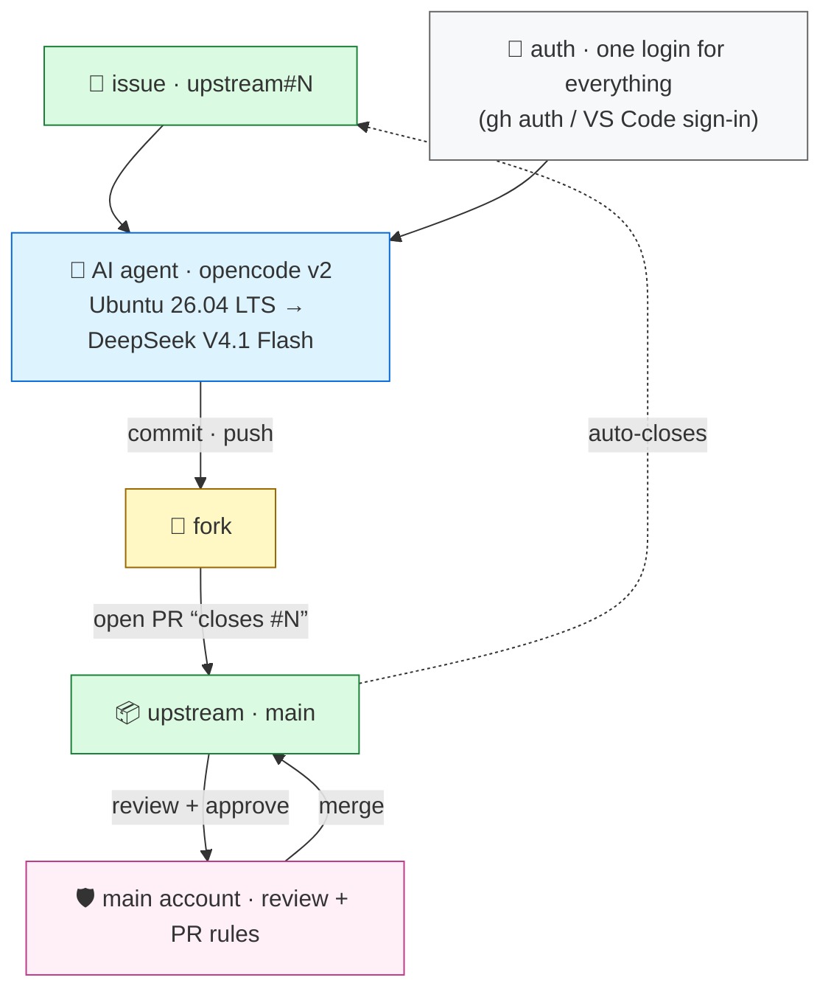

This is the **machine account** for [the main account](https://github.com/kapetao): a contributor
that does exactly one job — turn issues into pull requests, usually with an AI agent driving.

> ⚠️ **Do not build anything here.** This account only **forks** the upstream repos and sends pull
> requests. Create issues, content, and history in the **upstream** repos — never in the machine
> account. Its only non-fork is this profile.

- **Sign in once, use it anywhere.** Authentication is a single **gh auth** login.
- **Ubuntu 26.04 LTS** → **VS Code** → **opencode** → **DeepSeek V4.1 Flash**.
  - Via an API key budgeted at **~$1/day**. 

## Workflow — the relay

1. **Start clean.** Fetch the latest upstream `main`.
2. **Branch** for one issue (`<repo>:<issue>`).
3. **Implement + push**, open the PR with `Closes #N`.
4. **Delete the branch** once merged; the fork falls back to `main`.
5. **Unsure?** Comment on the issue and stop — resume later from a fresh `main`.

