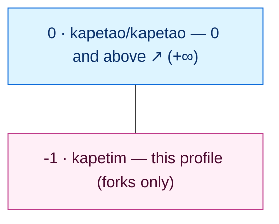

# kapetim

**Machine account for [`kapetao`](https://github.com/kapetao).**

This is the **machine account** set up by the human operator of `kapetao` to do one job:
open **pull requests** against `kapetao`'s public repositories, from forks.

A GitHub *machine account* is an account set up by a person who accepts the Terms of Service on
its behalf, used **exclusively for automated tasks**, and limited to **one** such account
alongside that person's own account. `kapetao` is the human/canonical account; `kapetim` is its
single machine account — the automation never touches `kapetao` directly.

This account handles **public repositories only**; the canonicals live in `kapetao`.

## Role

- **Fork** each public `kapetao` repo → `kapetim/<repo>` (one fork per repo).
- **Author pull requests** from those forks into `kapetao/<repo>:main`.
- **Never merge.** `kapetao` owns the canonicals and holds the approvals — every `kapetao` repo
  requires a PR with **1 approving review**, with admins enforced (no direct pushes).

```text
kapetim/<repo>  --PR-->  kapetao/<repo>:main        (reviewed & merged by kapetao)
```

## Repositories

This account sits one floor below `kapetao`: `-1` is this profile, `0` is
[`kapetao/kapetao`](https://github.com/kapetao/kapetao), and every fork maps onto a `kapetao`
public floor above it. Nothing canonical lives here — the forks are PR senders only.



<!-- BEGIN status-table -->
| Floor | Fork | Upstream | Tag | Size | CI |
|------:|------|----------|-----|------|----|
| ☀️ +9 | [ui-assets](https://github.com/kapetim/ui-assets) | [kapetao/ui-assets](https://github.com/kapetao/ui-assets) | — | — | — |
| ☀️ +8 | [pkg-manager](https://github.com/kapetim/pkg-manager) | [kapetao/pkg-manager](https://github.com/kapetao/pkg-manager) | — | — | — |
| ☀️ +7 | [radar](https://github.com/kapetim/radar) | [kapetao/radar](https://github.com/kapetao/radar) | — | — | — |
| ☀️ +6 | [journal](https://github.com/kapetim/journal) | [kapetao/journal](https://github.com/kapetao/journal) | — | — | — |
| ☀️ +5 | [browser-games](https://github.com/kapetim/browser-games) | [kapetao/browser-games](https://github.com/kapetao/browser-games) | — | — | — |
| ☀️ +4 | [ai-training](https://github.com/kapetim/ai-training) | [kapetao/ai-training](https://github.com/kapetao/ai-training) | — | — | — |
| ☀️ +3 | [browser-extensions](https://github.com/kapetim/browser-extensions) | [kapetao/browser-extensions](https://github.com/kapetao/browser-extensions) | — | — | — |
| ☀️ +2 | [interviewing](https://github.com/kapetim/interviewing) | [kapetao/interviewing](https://github.com/kapetao/interviewing) | — | — | — |
| ☀️ +1 | [cli](https://github.com/kapetim/cli) | [kapetao/cli](https://github.com/kapetao/cli) | — | — | — |
| 🏢 0 | [kapetao](https://github.com/kapetao/kapetao) | — | — | — | — |
| 🌑 -1 | [kapetim](https://github.com/kapetim/kapetim) *(this profile)* | — | — | — | — |
<!-- END status-table -->
