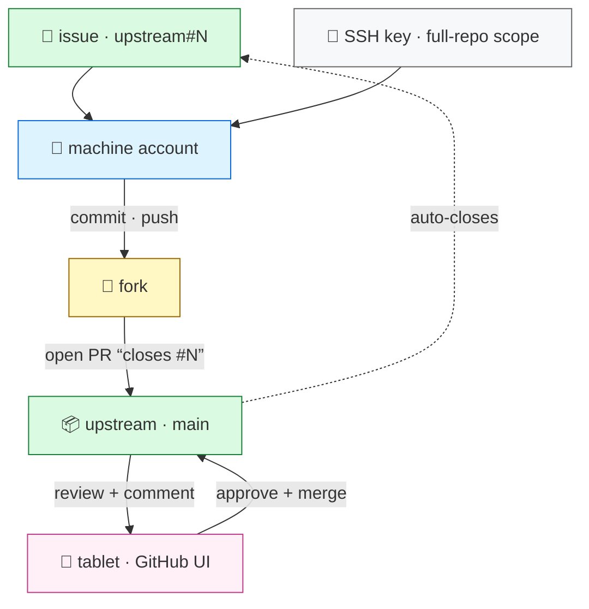

# Machine account

**Contributor — clone freely, ship pull requests. Never merge.**

This is the **machine account** for [the main account](https://github.com/kapetao): a contributor
that does exactly one job — turn issues into reviewed pull requests.

- **Clone freely** over **SSH** with a full-repo key.
- **One branch per issue**, cut from a clean, up-to-date `main`; push it to the fork and open a PR
  that **closes the linked issue**.
- **Never merge.** [The main account](https://github.com/kapetao) reviews, approves (one review),
  and merges.

## Workflow — the relay

1. **Start clean.** Fetch the latest upstream `main` and branch from it. Never continue a stale branch.
2. **Branch** for one issue (`<repo>:<issue>`).
3. **Implement + push**, open the PR with `Closes #N`.
4. **Delete the branch** once merged; the fork falls back to `main`.
5. **Unsure?** Comment on the issue and stop — resume later from a fresh `main`.

Pick up exactly where the last runner stopped, but never keep running on an outdated baton.

